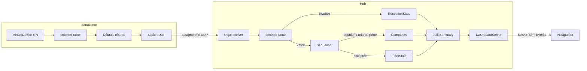

# PulseHub

Projet de rattrapage MT4 — Aboubakar Bamba.

Hub central de télémétrie pour équipements d'événementiel (protocole PulseHub v1 sur UDP), avec un simulateur d'appareils et un tableau de bord web temps réel destiné à la régie.

## 1. Démarrage local

### Prérequis

- Node.js 20.12 ou plus récent (testé avec Node 20.19)
- npm 10

### Installation

```bash
npm install
```

La configuration par défaut fonctionne sans fichier `.env`. Pour modifier un paramètre (port, seuils, délais), copier `.env.example` en `.env` et l'éditer.

### Lancer le hub et la visualisation

```bash
npm run hub
```

Le hub écoute en UDP sur le port 9000 et sert le tableau de bord sur http://localhost:3000. Ouvrir cette adresse dans un navigateur : toutes les valeurs sont à zéro tant qu'aucune trame n'est reçue.

### Lancer le simulateur

Dans un second terminal :

```bash
npm run sim
```

Par défaut : 50 appareils à 20 Hz, soit 1 000 trames/s. Avec injection de défauts :

```bash
npm run sim -- --bad-checksum 0.02 --duplicate 0.01 --reorder 0.01 --abnormal 0.005 --overheat 2 --stop 3
```

| Option | Effet |
|---|---|
| `--devices <n>` / `--hz <n>` | Nombre d'appareils / trames par seconde par appareil |
| `--bad-checksum <taux>` | Proportion de trames au checksum faux (0 à 1) |
| `--duplicate <taux>` | Proportion de trames envoyées deux fois |
| `--reorder <taux>` | Proportion de trames inversées avec la suivante du même appareil |
| `--abnormal <taux>` | Proportion de télémétries portant une valeur aberrante |
| `--overheat <n>` | Les n premiers appareils chauffent progressivement (+0,6 °C/s) |
| `--stop <n>` / `--stop-after <s>` | Les n derniers appareils cessent d'émettre après s secondes |

`npm run sim -- --help` affiche la liste complète.

### Tests et qualité

```bash
npm test           # tests unitaires (Vitest)
npm run lint       # ESLint
npm run typecheck  # vérification TypeScript
```

## 2. Architecture



Parcours d'une trame :

1. Le simulateur fabrique une trame (`Frame`), l'encode en binaire, applique éventuellement un défaut réseau et l'envoie en UDP.
2. `UdpReceiver` reçoit le datagramme et le transmet sans rien connaître du protocole.
3. `decodeFrame` vérifie taille, magic, version, type, longueur, checksum, deviceId et mesures. Une trame invalide est comptée par raison de rejet, sans exception.
4. `Sequencer` compare le `seq` au dernier vu pour cet appareil : nouvelle trame acceptée, doublon ou retard écartés, trous comptés comme pertes.
5. `FleetState` met à jour les dernières valeurs de l'appareil (converties en °C, V, A).
6. `buildSummary` assemble réception et flotte en un objet `HubSummary`, poussé au navigateur toutes les 500 ms.

Organisation du code :

| Dossier | Contenu |
|---|---|
| `src/protocol/` | Types du protocole, décodeur, encodeur, checksum |
| `src/simulator/` | Appareil virtuel, défauts réseau, CLI |
| `src/hub/` | Réception, séquenceur, synthèse, configuration |
| `src/hub/dashboard/` | Serveur HTTP et page du tableau de bord |
| `test/` | Tests unitaires, même arborescence que `src/` |

## 3. Synthèse et visualisation

### Ce que la synthèse calcule

Santé de la réception :

- trames reçues, acceptées, invalides (détaillées par raison), doublons, retards, pertes ;
- taux de perte en pourcentage : `pertes / (acceptées + pertes)` ;
- débit en trames par seconde.

État de chaque appareil :

- dernières valeurs de température, tension et courant ;
- temps écoulé depuis la dernière trame, pertes, nombre de télémétries hors limites ;
- un statut parmi quatre, accompagné de la raison en clair.

| Statut | Condition (valeurs par défaut, configurables) |
|---|---|
| Muet | Aucune trame depuis plus de 3 s |
| Critique | Température > 75 °C, tension hors 22–26 V ou courant > 10 A |
| Chaud | Température > 60 °C |
| OK | Aucun seuil dépassé |

Le statut muet est prioritaire : les dernières valeurs d'un appareil qui ne répond plus sont périmées.

### Pourquoi c'est utile à une régie

Un régisseur n'a pas le temps de lire 1 000 valeurs par seconde. Il doit savoir en quelques secondes si tout va bien et, sinon, quel appareil intervenir. La synthèse répond à trois questions :

- La flotte est-elle saine ? Nombre d'appareils par statut.
- Quel appareil pose problème, et pourquoi ? Liste « À surveiller », triée par gravité, avec la raison.
- Peut-on faire confiance aux chiffres ? Taux de perte et trames invalides : une réception dégradée signale un problème réseau sur le site.

Un taux en pourcentage est préféré aux totaux bruts, qui ne font qu'augmenter et ne disent rien de la situation actuelle.

### Pourquoi une page web

L'utilisateur final est un régisseur, pas un développeur : un affichage en terminal est lisible pour l'équipe technique mais pas pour lui. Une page web permet des couleurs, de gros chiffres et une disposition claire, et s'ouvre sur n'importe quel poste du réseau.

Pour tenir dans la journée, la solution reste minimale : un seul fichier HTML sans framework, servi par le module `http` de Node, mis à jour par Server-Sent Events. Chaque statut est représenté par une couleur, une icône et un libellé, pour ne pas reposer sur la couleur seule.

## 4. Principes de conception

Les liens pointent vers le commit `f104793`.

### Séparation des responsabilités / responsabilité unique (S de SOLID)

Chaque étape du parcours est une classe ou une fonction distincte, assemblées uniquement dans le point d'entrée. La socket ne connaît pas le protocole, le séquenceur ne connaît que `deviceId` et `seq`, la page web n'affiche que ce qu'elle reçoit.

- Assemblage du parcours : [src/hub/main.ts#L21-L31](https://github.com/Aboubakar2004/AboubakarBamba_PuslseHub/blob/f104793fec5465c184570579f53f34f71d685785/src/hub/main.ts#L21-L31)
- Socket sans connaissance du protocole : [src/hub/udpReceiver.ts#L9-L24](https://github.com/Aboubakar2004/AboubakarBamba_PuslseHub/blob/f104793fec5465c184570579f53f34f71d685785/src/hub/udpReceiver.ts#L9-L24)

### Ouvert/fermé (O de SOLID)

Les défauts du simulateur implémentent une interface commune `PacketFault`. Ajouter un défaut revient à ajouter une classe, sans modifier les autres ni la chaîne qui les applique.

- [src/simulator/faults.ts#L8-L75](https://github.com/Aboubakar2004/AboubakarBamba_PuslseHub/blob/f104793fec5465c184570579f53f34f71d685785/src/simulator/faults.ts#L8-L75)

### Injection de dépendances

Les dépendances sont passées au constructeur ou en paramètre plutôt que créées à l'intérieur : la fonction aléatoire des défauts, l'heure courante (`nowMs`) de la synthèse, la source de la synthèse pour le serveur web. Les tests peuvent ainsi simuler le hasard et le temps.

- Source de la synthèse injectée dans le serveur : [src/hub/dashboard/dashboardServer.ts#L12-L23](https://github.com/Aboubakar2004/AboubakarBamba_PuslseHub/blob/f104793fec5465c184570579f53f34f71d685785/src/hub/dashboard/dashboardServer.ts#L12-L23)
- Temps passé en paramètre : [src/hub/fleetState.ts#L46-L51](https://github.com/Aboubakar2004/AboubakarBamba_PuslseHub/blob/f104793fec5465c184570579f53f34f71d685785/src/hub/fleetState.ts#L46-L51)
- Hasard injecté dans les défauts : [src/simulator/faults.ts#L15-L19](https://github.com/Aboubakar2004/AboubakarBamba_PuslseHub/blob/f104793fec5465c184570579f53f34f71d685785/src/simulator/faults.ts#L15-L19)

### DRY

Les règles de seuil sont écrites une seule fois dans `findIssues`, réutilisées pour le statut, le comptage des valeurs hors limites et les messages affichés. La conversion des paramètres numériques est centralisée dans `parseNumber`.

- [src/hub/deviceStatus.ts#L32-L63](https://github.com/Aboubakar2004/AboubakarBamba_PuslseHub/blob/f104793fec5465c184570579f53f34f71d685785/src/hub/deviceStatus.ts#L32-L63)
- [src/shared/env.ts#L20-L55](https://github.com/Aboubakar2004/AboubakarBamba_PuslseHub/blob/f104793fec5465c184570579f53f34f71d685785/src/shared/env.ts#L20-L55)

### KISS

Aucune dépendance à l'exécution : `node:dgram` pour l'UDP, `node:http` pour le web, Server-Sent Events plutôt que WebSocket puisque seul le serveur émet, `parseArgs` de Node pour la CLI.

- [src/hub/dashboard/dashboardServer.ts#L43-L72](https://github.com/Aboubakar2004/AboubakarBamba_PuslseHub/blob/f104793fec5465c184570579f53f34f71d685785/src/hub/dashboard/dashboardServer.ts#L43-L72)

### Gestion des erreurs

Une trame invalide est une valeur, pas une exception : le décodeur renvoie `{ ok: false, reason }`. Une erreur imprévue dans le traitement d'un datagramme est comptée sans arrêter le hub. Un paramètre de configuration invalide arrête le démarrage avec un message explicite.

- Résultat typé du décodeur : [src/protocol/types.ts#L44-L57](https://github.com/Aboubakar2004/AboubakarBamba_PuslseHub/blob/f104793fec5465c184570579f53f34f71d685785/src/protocol/types.ts#L44-L57) et [src/protocol/decoder.ts#L30-L71](https://github.com/Aboubakar2004/AboubakarBamba_PuslseHub/blob/f104793fec5465c184570579f53f34f71d685785/src/protocol/decoder.ts#L30-L71)
- Isolation des erreurs de traitement : [src/hub/udpReceiver.ts#L13-L23](https://github.com/Aboubakar2004/AboubakarBamba_PuslseHub/blob/f104793fec5465c184570579f53f34f71d685785/src/hub/udpReceiver.ts#L13-L23)

### Configuration externalisée

Ports, seuils et délais sont lus dans l'environnement avec des valeurs par défaut et des bornes ; des seuils incohérents sont refusés au démarrage. La liste complète est dans `.env.example`.

- [src/hub/config.ts#L17-L40](https://github.com/Aboubakar2004/AboubakarBamba_PuslseHub/blob/f104793fec5465c184570579f53f34f71d685785/src/hub/config.ts#L17-L40)

## 5. Choix et compromis

### Outils retenus

| Outil | Raison |
|---|---|
| TypeScript en mode strict | Imposé ; le mode strict sécurise les lectures d'octets (`noUncheckedIndexedAccess`) |
| tsx | Exécute le TypeScript directement, sans étape de build |
| Vitest | Tests en TypeScript sans configuration |
| ESLint | Qualité du code |

### Outils écartés

| Outil | Raison |
|---|---|
| NestJS, Express | Une page et trois routes ne justifient pas un framework |
| WebSocket, socket.io | Communication bidirectionnelle inutile : seul le hub envoie des données |
| React ou autre framework front | Une page unique se met à jour en quelques lignes de JavaScript |
| dotenv, commander | Remplacés par `process.loadEnvFile` et `util.parseArgs`, intégrés à Node |
| Bibliothèque de parsing binaire | Interdite par le sujet |

### Gestion des pertes

Le séquenceur retient pour chaque appareil le dernier `seq` accepté et les `seq` manquants récents (fenêtre de 64, configurable). Quand une trame en retard finit par arriver, elle est écartée car sa valeur est périmée, mais la perte correspondante est annulée : une trame n'est comptée comme perdue que si elle n'arrive jamais. Au-delà de la fenêtre, un doublon ne peut plus être distingué d'un retard ; la trame est écartée dans les deux cas. Une trame au checksum faux crée un trou dans la séquence et compte donc aussi comme perdue, ce qui est exact du point de vue de la régie.

### Simplifications

- L'état est conservé en mémoire uniquement ; un redémarrage du hub repart de zéro.
- Les compteurs de réception sont cumulés depuis le démarrage du hub, seuls le débit et les statuts reflètent l'instant présent.
- Un statut est calculé sur la dernière valeur reçue, sans condition de durée.

## 6. Limites connues

- Le retour à zéro du compteur `seq` et le redémarrage d'un appareil ne sont pas gérés par le hub : après un redémarrage, ses trames seraient écartées comme en retard et l'appareil apparaîtrait muet.
- Une valeur aberrante isolée rend l'appareil critique pendant une seule trame ; elle reste visible via le compteur de valeurs hors limites.
- Le débit maximal soutenu par le hub n'a pas été mesuré.
- Le tableau de bord n'a pas d'authentification et envoie la synthèse complète à chaque rafraîchissement, ce qui convient pour quelques centaines d'appareils.
- Le serveur web et la socket UDP ne sont pas couverts par des tests automatisés ; ils ont été vérifiés manuellement avec le simulateur.

## 7. Usage de l'IA

Outil utilisé : Claude Code (Anthropic), dans VS Code.

- Compréhension du sujet et des notions (UDP, checksum, séquencement).
- Proposition de l'architecture et du découpage en branches.
- Génération d'une partie du code et des tests, relus et validés étape par étape.
- Vérification du fonctionnement (exécution du hub et du simulateur, captures du tableau de bord).
- Rédaction de ce README.

Les choix de conception ont été discutés et validés avant chaque étape, et l'ensemble du code a été relu pour pouvoir être expliqué en soutenance.
